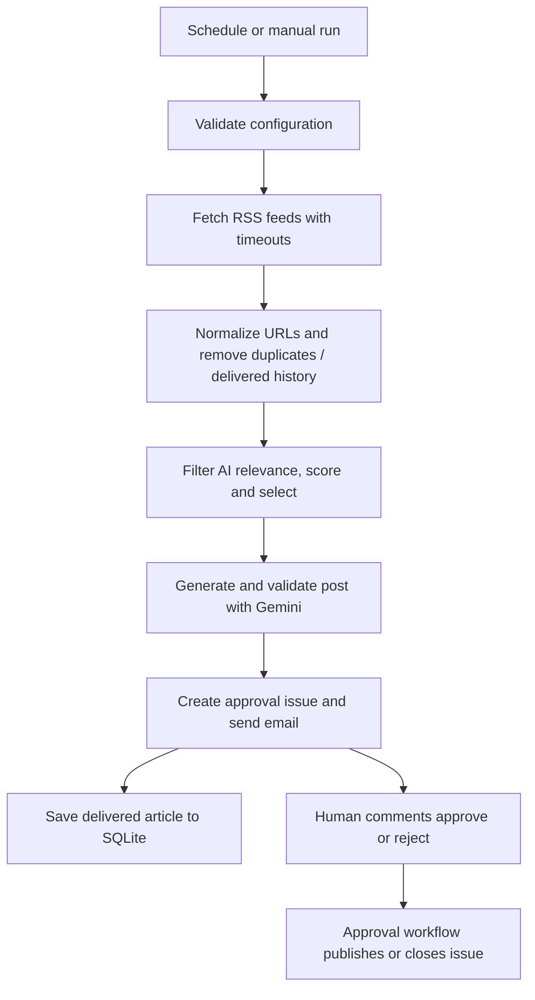

# AI News Fetching Agent

This workspace also includes **Chatcheck**, a chatbot test engine with a 76-test
clothing-store library, deterministic demo targets, and 12 single-bug mutants.
See [its setup, CLI commands, target configs and test format](docs/chatcheck.md).
The [Phase 2A guide](docs/chatcheck-judging.md) covers opt-in Gemini/OpenAI
judging, blinded labeling, stratified sampling and agreement metrics.
The [Phase 2B reporting guide](docs/chatcheck-reports.md) covers client HTML/PDF
reports, redaction and before/after comparisons; [sample reports](reports/meher_threads/samples/README.md)
show the weak and hardened demo targets.
The [operations guide](docs/chatcheck-operations.md) covers editable/wheel installation,
Chromium PDF export, `chatcheck init`, and confirmed deletion with `chatcheck purge`.
The [real LLM guide](docs/chatcheck-real-llm.md) covers Gemini/OpenAI targets,
persistent call caps, paraphrase review candidates and the real-response labeling quota.
The [retry guide](docs/chatcheck-retries.md) covers a separate explicit retry cap
and response-only scores; the [tuning protocol](tuning-protocol.md) protects the
held-out suite and requires human review plus a changelog for MAIN revisions.
The [mutation audit](reports/meher_threads/mutation/README.md) records original
coverage gaps, added tests, dead tests, and an untuned 20-test held-out evaluation.

A Python agent that collects AI news from RSS feeds, filters and ranks articles,
asks Gemini to draft a LinkedIn post, and delivers the draft through email and a
GitHub approval issue. LinkedIn publishing happens only after an authorized human
comments `approve` on the issue.

## Architecture



| File | Responsibility |
| --- | --- |
| `main.py` | CLI, environment checks, logging, configuration validation and exit codes |
| `src/agent.py` | Pipeline coordination and delivery/failure handling |
| `src/fetcher.py`, `src/dedup.py`, `src/utils.py` | RSS fetching, text cleanup and URL/title normalization |
| `src/scorer.py`, `src/selector.py` | Relevance scoring and article selection |
| `src/generator.py` | Primary/fallback Gemini generation, retries and post validation |
| `src/database.py` | SQLite initialization, legacy migration and history seeding |
| `src/emailer.py`, `src/github_issues.py` | Email delivery and approval issues |
| `src/linkedin_poster.py` | LinkedIn API publishing after approval |
| `src/env_safety.py` | Detect tracked `.env` files locally; warn and continue in CI or on Git errors |
| `setup_linkedin.py` | One-time OAuth authorization and member URN lookup |
| `.github/workflows/` | News schedule, approval handling and tests |

Generation failures do not create approval issues or mark the article delivered.
If both email and issue creation fail, the article also remains available for
retry. One successful delivery channel is enough to record the article. History
records delivery for review, not proof of publication on LinkedIn.

## Local setup

Use Python 3.12 and Git. Run commands from the repository root.

```bash
git clone https://github.com/talharizwan166-code/AI_News_Fetching_Agent.git
cd AI_News_Fetching_Agent
python -m venv .venv
```

Activate the virtual environment:

```powershell
# Windows PowerShell
.\.venv\Scripts\Activate.ps1
```

```bash
# Linux/macOS
source .venv/bin/activate
```

Install dependencies, then create your local configuration:

```bash
python -m pip install -r requirements-dev.txt
```

```powershell
# Windows: only when .env does not already exist
Copy-Item .env.example .env
```

```bash
# Linux/macOS: only when .env does not already exist
cp .env.example .env
```

Edit `.env` privately. Fill the Gemini and email credentials before running the
agent. Real environment variables take precedence over values in `.env`.
Production-only installation can use `requirements.txt` without pytest.

### Gemini API key

1. Sign in to [Google AI Studio](https://aistudio.google.com/api-keys).
2. Select or import your Google Cloud project and create an API key.
3. Put the value in local `GEMINI_API_KEY` and the matching GitHub Actions Secret.
4. Check the project's model access, quota and billing settings. The configured
   primary/fallback names must be available to that project; model defaults in
   this repository are listed below.

See Google's [API key setup and restrictions](https://ai.google.dev/gemini-api/docs/api-key).
Do not put a key in source code, screenshots or issue comments.

### Gmail app password

1. Enable [2-Step Verification](https://myaccount.google.com/security) on the
   Google account that will send the email.
2. Open [App passwords](https://myaccount.google.com/apppasswords), create one for
   this agent, and keep it privately.
3. Set `EMAIL_SENDER` to that account, `EMAIL_PASSWORD` to the generated app
   password (without grouping spaces), and `EMAIL_RECIPIENT` to your destination.
4. Use `EMAIL_SMTP_HOST=smtp.gmail.com` and `EMAIL_SMTP_PORT=587`; the sender uses
   STARTTLS. Never use the account's normal login password here.

Some organization/security policies disable app passwords. Changing your Google
account password revokes existing app passwords; generate a replacement then.
See Google's [app-password instructions](https://support.google.com/accounts/answer/185833).

## Environment variables

Blank credential fields in `.env.example` must be filled privately. The example
contains defaults and placeholders only. Missing, empty, and whitespace-only
values use defaults. Invalid numbers report the variable name without its value.
Required credentials are reported together when missing.

| Variable | Local default / purpose |
| --- | --- |
| `GEMINI_API_KEY` | Required: Gemini credential |
| `GEMINI_MODEL` | `gemini-3.5-flash`: primary model |
| `GEMINI_FALLBACK_MODEL` | `gemini-3.5-flash-lite`: fallback model |
| `GEMINI_MAX_RETRIES` | `3`: configured generation retry limit |
| `GEMINI_RETRY_WAIT_MIN` | `2`: minimum retry wait, seconds |
| `GEMINI_RETRY_WAIT_MAX` | `30`: maximum retry wait, seconds |
| `EMAIL_SENDER` | Required: sending mailbox |
| `EMAIL_PASSWORD` | Required: Gmail app password or provider SMTP credential |
| `EMAIL_RECIPIENT` | Required: receiving mailbox |
| `EMAIL_SMTP_HOST` | `smtp.gmail.com` |
| `EMAIL_SMTP_PORT` | `587` |
| `GITHUB_TOKEN` | Local credential for approval issues; Actions provides its own job token |
| `GITHUB_REPOSITORY` | Local `owner/repository`; Actions supplies the current repository |
| `LINKEDIN_ACCESS_TOKEN` | Optional: OAuth access token for approval-time publishing |
| `LINKEDIN_PERSON_URN` | Optional: member identifier produced by setup, shaped like `urn:li:person:...` |
| `LINKEDIN_API_VERSION` | `202610`: supported default verified on 2026-10-15; local environment override |
| `LINKEDIN_CLIENT_ID` | Setup script only: app Client ID, or interactive prompt |
| `LINKEDIN_CLIENT_SECRET` | Setup script only: app Client Secret, or hidden prompt |
| `LINKEDIN_REDIRECT_URI` | Setup script only: `https://www.linkedin.com/developers/tools/oauth/redirect`, or `--redirect-uri` |
| `DB_PATH` | `news_agent.db`; parent directory must already exist |
| `FETCH_TIMEOUT_SECONDS` | `15`: timeout per RSS request |
| `MIN_QUALITY_THRESHOLD` | `0.25`: minimum aggregate article score |
| `MIN_AI_RELEVANCE` | `0.30`: minimum AI relevance score |
| `LOG_LEVEL` | `INFO`; use `DEBUG`, `WARNING` or `ERROR` as needed |
| `DRY_RUN` | `0`; `1`, `true` or `yes` enables dry-run |

Scoring overrides are supported through `SCORING_WEIGHT_AI_RELEVANCE` (0.30),
`SCORING_WEIGHT_DEVELOPER_RELEVANCE` (0.20), `SCORING_WEIGHT_INNOVATION` (0.20),
`SCORING_WEIGHT_FRESHNESS` (0.15), and `SCORING_WEIGHT_SOURCE_CREDIBILITY` (0.15).
Each weight and relevance threshold must be between 0 and 1; weights must sum
to 1. Timeout, port, and retry settings are also checked before agent processing.

`main.py` currently validates all four required Gemini/email fields even with
`--dry-run`. A local GitHub token is only needed if you want approval-issue
creation; email-only delivery can still succeed. Give a local fine-grained token
access to this repository and permission to write issues.

## GitHub Actions configuration

Under **Settings → Secrets and variables → Actions → New repository secret**, add:

| Secret | Purpose |
| --- | --- |
| `GEMINI_API_KEY` | Generate the draft |
| `EMAIL_SENDER`, `EMAIL_PASSWORD`, `EMAIL_RECIPIENT` | Deliver the review email; existing aliases below are also accepted |
| `EMAIL_SMTP_HOST`, `EMAIL_SMTP_PORT` | Optional: default to `smtp.gmail.com` and `587` |
| `LINKEDIN_ACCESS_TOKEN`, `LINKEDIN_PERSON_URN` | Optional: publish approved posts to your account |

The news workflow accepts existing repository secrets `SENDER_EMAIL`,
`SENDER_PASSWORD`, and `RECEIVER_EMAIL` as fallbacks for `EMAIL_SENDER`,
`EMAIL_PASSWORD`, and `EMAIL_RECIPIENT`, respectively. The canonical name wins
when both are set. This mapping applies to both early validation and the agent
step; no secret values are printed by validation. Local `.env` files use the
canonical `EMAIL_*` names.

Missing optional SMTP secrets arrive as empty strings and use Python defaults.
Do not create a personal `GITHUB_TOKEN` secret for Actions. The workflow uses
`${{ github.token }}` with `contents: write`, `issues: write` and `actions: read`.
Repository/organization policy must permit those job permissions.

OAuth Client ID/Secret are used locally during setup and are not required by
the approval workflow. Local tuning variables do not automatically become Actions
settings: add an explicit `env:` entry to the relevant workflow to override them.
The approval workflow reads its LinkedIn API version from a repository variable,
as described below.

### LinkedIn API version

The default `LinkedIn-Version` header is **`202610` (October 2026)**, verified on
2026-10-15 against the official [Marketing API versioning table](https://learn.microsoft.com/en-us/linkedin/marketing/versioning).
Local posting reads `LINKEDIN_API_VERSION` from the environment. In GitHub Actions,
set the repository **variable**, not Secret, `LINKEDIN_API_VERSION` under Settings →
Secrets and variables → Actions → Variables. The approval workflow uses
`${{ vars.LINKEDIN_API_VERSION || '202610' }}` and passes it to Python.
Recheck supported versions before a sunset; neither local nor hosted posting
automatically discovers future versions. HTTP 426 produces a version-specific
issue comment with instructions to update the variable. HTTP 401 instead provides
token renewal instructions.

## LinkedIn one-time setup and renewal

1. Create/select an app in the [LinkedIn Developer Portal](https://www.linkedin.com/developers/apps).
2. Request the **Sign In with LinkedIn using OpenID Connect** and **Share on
   LinkedIn** products. The setup flow requests `openid profile w_member_social`.
3. In the app's Auth settings, register the exact redirect URI
   `https://www.linkedin.com/developers/tools/oauth/redirect` (or configure your own matching HTTPS URI).
4. Run:

   ```bash
   python setup_linkedin.py
   ```

5. Use the prompts for Client ID and Client Secret, or provide
   `LINKEDIN_CLIENT_ID` / `LINKEDIN_CLIENT_SECRET` through `.env` or your shell.
   The secret prompt is hidden; credentials are not passed on the command line.
6. Authorize the app in your browser. Copy the **complete redirected address from
   the address bar**, including `code` and `state`, into the hidden prompt. A raw
   code displayed on the redirect page alone is not accepted.
7. The script validates the callback address and random OAuth state, exchanges
   the code, and calls `/v2/userinfo` to derive the person URN from `sub`.
8. Open the generated, ignored `.env.linkedin` file privately. Copy its two
   complete assignment lines into your local `.env`. For GitHub Actions Secrets,
   copy only each value inside the quotes, without the quotes or variable name.
   The script does not print the token or automatically edit `.env`.

Use `--no-browser` to open the displayed authorization link yourself. For a custom
callback use `--redirect-uri` and register that same address with LinkedIn.
The old `get_linkedin_id.py` has been replaced by this single script.

Access tokens usually last about **60 days**; the script shows the expiry derived
from `expires_in`, which takes precedence over that estimate. Tokens can be
revoked earlier. This project does not automatically refresh them. Renew before
expiry, or after a 401 response:

```bash
python setup_linkedin.py --output .env.linkedin.new
```

Replace `LINKEDIN_ACCESS_TOKEN` and `LINKEDIN_PERSON_URN` in GitHub Secrets/local
configuration, then retry approval. Existing output files are never overwritten;
use a fresh ignored `.env.linkedin.*` name for subsequent renewals. Never paste
credentials into chat, issues or workflow logs.

References: [OpenID Connect/userinfo](https://learn.microsoft.com/en-us/linkedin/consumer/integrations/self-serve/sign-in-with-linkedin-v2),
[OAuth authorization and token lifetime](https://learn.microsoft.com/en-us/linkedin/shared/authentication/authorization-code-flow).

## Run commands and exit codes

```bash
python main.py
python main.py --dry-run
python main.py --dry-run --verbose
python -m src.check_feeds --timeout 15
```

Dry-run still fetches RSS and calls Gemini, so it requires internet and can consume
API quota. It prints the proposed article/post but sends no email, creates no
issue and performs no database writes. Existing history is read-only, including
legacy schemas; a missing DB is treated as empty and is not created.

| Result | Exit code |
| --- | --- |
| Successful delivery, or successful dry-run | `0` |
| `no_articles`, `all_published`, `below_threshold` | `0` (nothing actionable) |
| `gemini_failed`, `delivery_failed`, configuration/database/unhandled errors | Non-zero |

The hosted news workflow runs at **05:00 and 05:30 UTC** (10:00 and 10:30 PKT).
Scheduled runs skip after an earlier successful workflow run on the same UTC day.
Manual runs always bypass that guard. API-check errors warn and allow processing.
A failed job leaves the backup eligible. A successful no-action run also counts
as success for the guard.

Manual trigger: **Actions → AI News Agent → Run workflow → main → Run workflow**.
Logs should show preparation, either a seed or existing-history message, agent
processing, and a database push or an explicit unchanged-DB skip. The manual guard
message says it is bypassing the already-ran-today check. Startup logs include
`GITHUB_SHA`, the dry-run flag, and missing optional variable names. Logging is
configured before the CI guard and uses timestamp, level, and module name.

## Approval flow

- The agent emails the draft and creates an issue labelled `linkedin-pending`.
- An owner, member or collaborator comments exactly `approve` or `reject`.
- With token and person URN configured, `approve` publishes using LinkedIn's API,
  adds an acknowledgement and closes the issue after success.
- With only the token configured, approval supplies a manual-share link and post
  text. Without a token, the workflow comments with configuration instructions.
  The email also provides a manual copy/share route without LinkedIn credentials.
- `reject` acknowledges rejection and closes the issue. Delivered-history records
  remain, so rejection does not automatically make the article eligible again.
- An expired/revoked token leaves publishing unsuccessful; replace the credentials
  and comment `approve` again. Do not retry an already-published issue.

## Database persistence and initial history

Local runs use the ignored `news_agent.db`. Cloud runs use
`data-branch/news_agent.db` inside the workspace; local and cloud DBs are separate.
The workflow checks out application code from `main` and the existing `data`
branch into `data-branch/`, retaining checkout credentials. When the branch is
absent it creates an orphan worktree. It then migrates the database, repairing
missing or stale normalized URLs without deleting published history.

Only when the DB has zero article rows, `data/seed_published.json` seeds the three
historical records exported from the original local DB. It contains only public
URL/title/source metadata. Import uses normalized URLs and `INSERT OR IGNORE`, so
repeated imports do not duplicate or overwrite history. Editing this JSON does not
reseed an already-populated cloud DB.

After a successful agent step, the workflow stages the ignored DB only if present,
checks for changes, amends the data commit without an editor, and force-pushes
**only `data`** when there are changes. Failed/skipped agents, missing databases,
and unchanged databases skip persistence with a message. Git diff errors fail the
step before a commit or push. The job has a 20-minute timeout and persistence has
a 5-minute timeout; Git terminal prompts are disabled.
The branch is a current snapshot, not a backup archive; preserve independent
backups if you need older states. No DB is committed to `main`, and the workflow
never pushes application changes to `main`. A missing DB makes persistence exit
cleanly. A scheduled guard skip also skips the persistence step.

## Tests and workflow lint

```bash
python -m pip install -r requirements-dev.txt
python -m pytest tests/ -v
actionlint .github/workflows/news_agent.yml .github/workflows/tests.yml .github/workflows/linkedin_approve.yml
```

Tests use temporary databases and mocked Gemini/email/GitHub/LinkedIn requests.
They cover exit codes, read-only dry-runs, legacy migration, seed idempotence and
the empty-DB workflow rule. OAuth tests use fake credentials and never open a real
browser or authorize an account. Keep real credentials out of test fixtures.
Install actionlint outside the checkout or in ignored `.tools/`; do not extract its
README/license over this project's files. The Tests workflow runs pytest on main
pushes and pull requests, subject to its configured path filters.

## Environment-file hygiene

The agent CLI checks Git tracking **before loading `.env`**; the setup script uses
the same check. Outside CI, only a successful Git result confirming that `.env`
is tracked blocks startup. Missing Git, a non-repository directory, ownership or
other Git errors, and timeouts log a warning and continue. When `CI=true` or
`GITHUB_ACTIONS=true`, the guard warns and skips its Git query entirely, so this
check cannot stop the hosted job. The check never displays environment-file contents.

`.env`, `.env.*`, databases, `.venv/`, caches, `.tools/` and local progress/review
artifacts are ignored. `.env.example` is intentionally tracked with no real
credentials. If a credential was ever committed, removing the file alone does
not revoke it: replace the credential and address the historical exposure.

## Troubleshooting

| Symptom | Check / next action |
| --- | --- |
| Missing configuration | Fill the four required variables, or use the supported legacy email secret names. SMTP host/port are optional. |
| Empty `EMAIL_SMTP_PORT` causes an `int()` traceback | Check the run's commit SHA: current code uses `env_int` and defaults blank ports to 587. A rerun of an old workflow is not evidence that the new code ran. |
| Gmail authentication failure | Use a fresh app password, confirm 2-Step Verification and account policy, and use port 587 with STARTTLS. |
| Gemini 401/403/404 or quota errors | Check key restrictions, project/model access, model IDs and quota. Generation errors fail the job and leave the article available for retry. |
| LinkedIn setup state/callback mismatch | Start a fresh authorization and paste the full redirect address. It must match the registered redirect URI. |
| LinkedIn setup 403 / missing member ID | Enable OpenID Connect and Share on LinkedIn; reauthorize the requested scopes. `/v2/me` is not used as a fallback. |
| LinkedIn 401 | Token may be expired/revoked. Rerun setup, update the Secrets, and retry approval. |
| LinkedIn HTTP 426 / version sunset | Set repository variable `LINKEDIN_API_VERSION` to a supported `YYYYMM`; local posting uses the same-named environment variable. Both default to `202610`. Read the version-specific issue comment, update the setting, then comment `approve` again. |
| One RSS feed fails or returns 429 | Other feeds continue. Run the feed-health command and adjust `RSS_FEEDS` in `src/config.py` if needed. |
| No new email despite green job | Check `no_articles`, `all_published`, `below_threshold` and scheduled-skip messages. Use a manual run to bypass the day guard. |
| Workflow-history API 404 | The guard must reference `news_agent.yml` and have `actions: read`. Its API errors should warn instead of stopping the agent. |
| Database path/schema problem | Ensure the parent directory exists, use this version's migration, and keep the worktree inside `data-branch/`. Back up a DB before manual repairs. |
| Data push denied | Check `contents: write` and protection/rules on `data`; never solve it by force-pushing `main`. |

License: [MIT](LICENSE).
